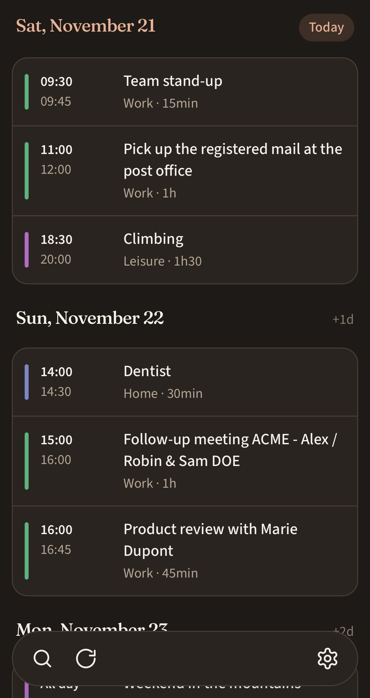
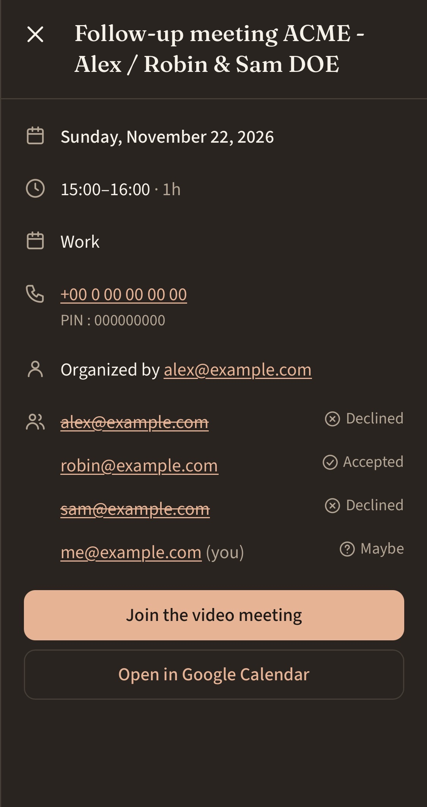
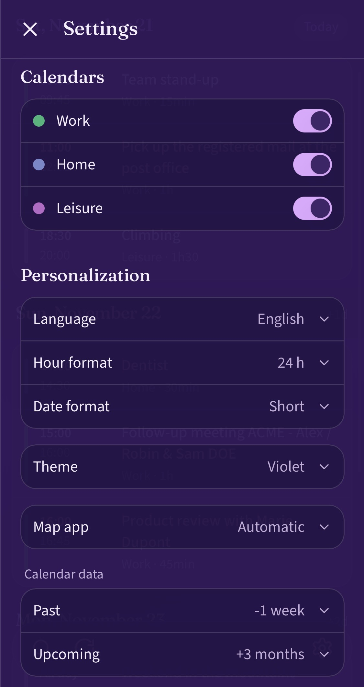

# Planning

All your Google calendars in one vertical list, on your phone, readable offline.

<p align="center">
  
  
  
</p>

- **One list** for every calendar you can see in Google Calendar, one day after the other.
- **Offline**: it opens on its local memory, with no network, and updates without blocking.
- **Read-only**: it asks Google for the read-only calendar scope and never writes.
- **Private**: you host it yourself, with your own Google credentials. Events stay on your device.
- **Installable**: a PWA, added to the home screen from Safari (iPhone first, Android should work).
- Six languages: English, French, Spanish, Italian, German, Vietnamese.

## Use it

Install it on a phone and sign in: [docs/operations/USER-GUIDE.md](docs/operations/USER-GUIDE.md).

## Host your own

Planning has no public instance: each person (or small group) runs their own, so that their Google account is the only one involved. You need a Google account, a free [Vercel](https://vercel.com) account and about 30 minutes.

1. Fork or clone this repository.
2. Create the Google credentials (Google Cloud project, Calendar API, read-only scope, OAuth client).
3. Deploy on Vercel with its environment variables (`.env.example` is the template).
4. Sign in and install it on your phone.

The step by step guide, with the Google Cloud and Vercel screens and the troubleshooting table, is [docs/operations/SETUP.md](docs/operations/SETUP.md).

To try the interface without Google:

```bash
pnpm install --frozen-lockfile
DEV_FAKE_DATA=1 pnpm dev
```

## Contribute

Read [CONTRIBUTING.md](CONTRIBUTING.md). The scope is deliberate: see [docs/context/PRODUCT.md](docs/context/PRODUCT.md). Architecture, decisions and commands are indexed in [docs/INDEX.md](docs/INDEX.md). Report a vulnerability as described in [SECURITY.md](SECURITY.md).

Built with Next.js (App Router, TypeScript), Tailwind v4, Vitest and Playwright.

## License

[MIT](LICENSE). The fonts (Fraunces, Source Sans 3) are under the SIL Open Font License. Not affiliated with Google; Google Calendar is a trademark of Google LLC.
