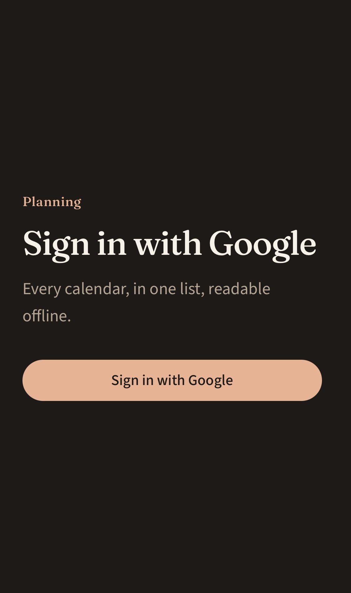

# User guide

This guide is for the person who uses the app. The person who hosts it (Google credentials, Vercel) follows [SETUP.md](SETUP.md).

## Install on the iPhone

1. Open the address of your Planning in **Safari**. Only Safari can add an app to the home screen.
2. Tap **Share**, then **Add to Home Screen**, then **Add**.
3. Open Planning from its icon and tap **Sign in with Google**. Do this once, online: it fills the memory of the app.

Google may show **Google hasn't verified this app** the first time. The person who hosts the app published it without Google's verification, which is expected: tap **Advanced**, then **Go to <app name> (unsafe)**, and accept the read-only access to your calendars.

If the account is refused with "This Google account is not allowed", ask the person who hosts the app to allow your Google address.

## Install on Android

Open the address in Chrome, open the menu, and choose **Install app** (or **Add to Home screen**). The rest is the same. Android has no dedicated work: it should work, it is not tested.

## Day to day

- **List**: all the upcoming events of all your calendars, one day after the other. The list opens on today; scroll up to see the past week.
- **Details**: tap an event to see its time, place, description, attendees and meeting link. Swipe right, tap outside or press Escape to close.
- **Search**: the magnifier icon filters the list by title, place, description or calendar name.
- **Sync**: the app updates itself when it opens and when you come back after more than 15 minutes. The sync button updates it at once. It never syncs in the background.
- **Offline**: after the first sign-in the list opens without a network. If a sync fails, the list stays and a message tells why.
- **Time zone**: the one of your device. All-day events keep their date.

## Settings

Open them with the gear icon (or `p` on a keyboard). You can choose which calendars are visible, the language (English, French, Spanish, Italian, German, Vietnamese), the 12 h or 24 h clock, the date format, the theme, the map app for addresses, how far back and ahead events are kept, a left-handed layout and sounds. They are stored on your device only.

**Sign out** revokes the access at Google and empties the memory of the app on this device.

## Keyboard shortcuts

| Key | Action |
| --- | --- |
| `p` | open or close the settings |
| `s` | search |
| `r` | sync (online only) |
| `n` / `b` | next / previous day |
| `t` | back to today |

## Privacy

The app only reads your calendars. It never writes to them. Your events are kept on your device, not on a server. The sign-in is kept in an encrypted cookie. See [THREAT-MODEL.md](../architecture/THREAT-MODEL.md).
